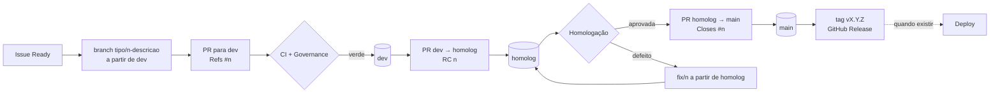
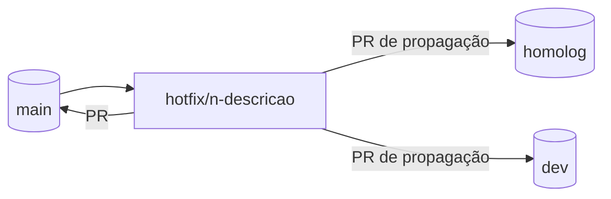

# Fluxo de desenvolvimento no GitHub

## Visão geral

| Branch | Recebe | Significa |
| --- | --- | --- |
| `dev` | PRs de implementação | integrado e com CI verde |
| `homolog` | promoção da `dev`, correções de homologação | em validação para a próxima release |
| `main` | release da `homolog`, hotfix | aprovado para produção (não necessariamente implantado) |

## Implementação

1. Issue em **Ready** ([issue-policy.md](issue-policy.md#definição-de-ready)), atribuída a quem vai
   trabalhar; estado **In Progress** e comentário "Desenvolvimento iniciado".
2. Branch a partir de `dev`: `git switch -c feat/51-demo-upload origin/dev`.
3. Commits pequenos (Conventional Commits, `Refs #51` quando ajudar).
4. PR para `dev` pelo [template](../../.github/PULL_REQUEST_TEMPLATE.md), com `Refs #51`; estado
   **In Review**.
5. Merge commit depois dos quatro checks verdes; comentário "Implementação integrada"; estado
   **In Homologation**. A issue continua aberta.

## Promoção para homologação

PR `dev → homolog`, título `chore(release): promote dev to homolog — RC n`, com as issues e PRs
incluídos, testes executados, riscos e o plano de homologação
([release-policy.md](release-policy.md#promoção-para-homologação)). Só se promove o que foi
selecionado: se a `dev` tiver trabalho não aprovado, o corte segue
[release-policy.md](release-policy.md#corte-parcial), nunca reescrevendo a `dev`.

Durante um ciclo de validação, a `homolog` só recebe correções de homologação.

## Homologação

Validação formal dos fluxos, regras, regressão, autorização, responsividade, falhas, desempenho e
acessibilidade relevantes. Resultado registrado no PR de promoção e nas issues (comentário
"Resultado da homologação"). Testes automatizados, inclusive os executados por agentes, são
evidência; a aprovação é do responsável humano.

Defeito na homologação:

1. Issue `[BUG]` (ou relação com a existente) e label `blocked` na issue afetada, se for o caso.
2. Branch `fix/<issue>-<descricao>` a partir de `homolog`, PR para `homolog`.
3. Validações afetadas executadas de novo.
4. PR de sincronização `homolog → dev` para a correção não se perder.

## Release

PR `homolog → main`, título `chore(release): promote homolog to main — vX.Y.Z`, com versão,
escopo, `Closes #n` só das issues concluídas e validadas, resultado da homologação, evidências,
riscos e rollback. Depois do merge: tag e GitHub Release no merge commit, estado **Done**, e
sincronização `main → homolog → dev` quando a `main` tiver commits que elas não têm.

## Hotfix

Falha crítica na versão aprovada:

Issue obrigatória com severidade, correção mínima, teste de regressão, CI, aprovação explícita do
procedimento pelo responsável e propagação às outras duas branches. Hotfix não libera push direto
nem desativa proteção.

## Exceções

| Exceção | Regra |
| --- | --- |
| Bootstrap da governança (#77) | PR único `infra/77-development-governance → main`, aceito pela verificação de governança só para esse nome; removido no primeiro ciclo completo |
| Dependabot | atualizações de versão → `dev`; de segurança → `main` como hotfix ([release-policy.md](release-policy.md#dependabot)) |
| Sincronização | PRs `main → homolog`, `main → dev` e `homolog → dev` sem issue própria |
| Recuperação técnica | branch sem issue só para recuperar dados ou histórico, registrada numa issue aberta logo depois |
